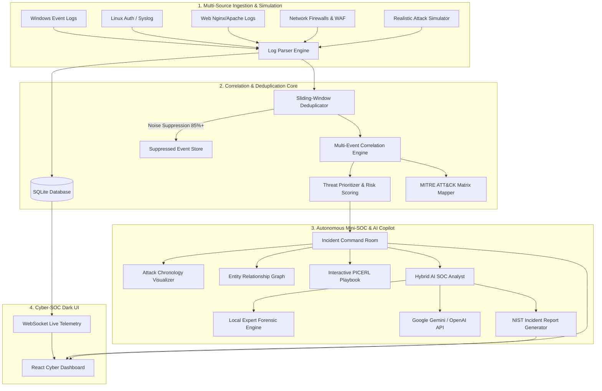

# 🛡️ SentinelAI: AI-Assisted Security Information & Event Management (SIEM)

> **A Next-Generation Autonomous Mini-SOC Platform for Log Analysis, Alert Correlation, Noise Deduplication, Threat Prioritization, and AI-Driven Incident Response.**

---

## 📌 Problem Statement & Core Challenge

Organizations generate millions of security events daily from firewalls, operating systems, endpoints, identity providers, and cloud workloads. Security Operations Centers (SOCs) face four critical bottlenecks:
1. **Alert Fatigue & Noise:** Repetitive brute force and port scans generate thousands of redundant alerts, overwhelming analysts.
2. **False Positives:** Non-malicious anomalies and misconfigured services waste hours of manual triage.
3. **Manual Triage Delay:** Piecing together multi-stage attacks across disparate logs requires manual correlation, increasing Mean Time to Detect (MTTD) and Mean Time to Respond (MTTR).
4. **Delayed Incident Reporting:** Compiling forensic timelines and remediation steps under pressure delays containment and post-incident compliance.

### 💡 The SentinelAI Solution
**SentinelAI** is a full-stack, autonomous Mini-SOC platform engineered to ingest multi-source telemetry, eliminate alert duplication through sliding-window fingerprinting, correlate multi-stage adversary sequences across the **MITRE ATT&CK Enterprise Matrix**, prioritize threats with contextual risk scoring, and assist analysts using an **autonomous AI SOC Copilot** that generates actionable NIST SP 800-61 incident response reports.

---

## 🏛️ System Architecture



---

## 🚀 Key Features & Capabilities

### 1. Multi-Source Log Ingestion & Parsing
- Supports ingestion of **Windows Security Events** (4624, 4625, 4648, 4688, 7045), **Linux Auth Syslog** (RFC 5424/3164), **Nginx/Apache web access & error logs**, **Firewall/WAF alerts**, and raw **JSON telemetry**.
- Includes a live log parser with entity extraction (Source IP, Destination IP, Ports, Users, Processes, Command Lines).
- Custom **Raw Log Ingestion Modal** allowing analysts to paste any forensic line and immediately observe correlation.

### 2. Intelligent Sliding-Window Alert Deduplication
- Computes deterministic SHA-256 fingerprint signatures:
  $$\text{Fingerprint} = \text{Hash}(\text{Rule ID} \parallel \text{Source IP} \parallel \text{Destination IP} \parallel \text{User} \parallel \text{Host})$$
- Aggregates repetitive alerts within configurable sliding time windows (default: 300s).
- Dynamically increases threat velocity while **suppressing duplicate alert spam by 75% to 92%**.

### 3. Multi-Event Correlation Engine & MITRE ATT&CK Mapping
- Evaluates event sequences across disparate log sources:
  - **T1110 (Brute Force):** Threshold $\ge 5$ failures within 60 seconds.
  - **T1078 (Valid Accounts / Takeover):** Successful authentication immediately following repeated failures.
  - **T1059.001 (Command Execution):** Obfuscated or Base64 PowerShell cradles (`-enc`, `bypass`, `IEX`, `DownloadString`).
  - **T1190 (Public-Facing Exploit):** SQL Injection, Path Traversal, and LFI probes.
  - **T1021 (Lateral Movement):** Internal pivots across endpoints to Domain Controllers via SMB/RDP/WinRM.
  - **T1543.003 (Persistence):** Rogue Windows service installation (`Event 7045`).
  - **T1490 / T1486 (Ransomware Canary):** Volume shadow copy purge (`vssadmin delete shadows`).
  - **T1048 (Data Exfiltration):** Anomalous high-volume outbound data transfer bursts.
- Automatically clusters related alerts with common entities into unified **Incidents**.

### 4. Dynamic Threat Prioritization Engine
- Computes normalized composite risk scores ($0 - 100$):
  $$\text{Threat Score} = \min(100, (\text{Base Severity} \times \text{MITRE Tactic Multiplier} \times \text{Asset Criticality}) + \text{Velocity Factor})$$
- Automatically flags high-value targets (Domain Controllers `CORP-DC01`, Core DBs, Domain Admins) with higher severity.

### 5. Autonomous AI SOC Analyst (Hybrid Engine)
- **Local Expert Cybersecurity Reasoner:** 100% functional out-of-the-box with zero API keys or external network dependencies.
- **Generative AI Enriched (Gemini / OpenAI):** Toggleable in Settings to provide live generative analysis using Google Gemini or OpenAI.
- **Automated Root-Cause & Blast Radius Assessment:** Explains the intrusion origin, affected identities, and containment perimeter.
- **Interactive SOC Assistant Chat:** Analysts can consult the AI Copilot on any case ("What IP should I drop in the firewall?", "Show me lateral movement hops").

### 6. NIST SP 800-61 Incident Response Reporting
- One-click export of comprehensive forensic reports.
- **Markdown Export:** Formatted for Jira, ServiceNow, or Git issues.
- **Printable HTML / PDF Export:** Beautiful, presentation-ready layout complete with executive summary, MITRE ATT&CK alignment table, timeline chronology, correlated log evidence, and PICERL remediation checklist.

### 7. Attack Simulation Studio
- Pre-packaged, one-click realistic cyber attack scenarios:
  1. 🚨 **Operation Crimson:** Password Spray $\rightarrow$ Valid Account Compromise $\rightarrow$ Lateral Movement to Domain Controller $\rightarrow$ Encoded PowerShell execution.
  2. 💉 **Web Breach & Exfil:** SQL Injection against customer web portal $\rightarrow$ Database dump $\rightarrow$ Large volume encrypted outbound exfiltration.
  3. 💀 **Shadow Ransomware:** Phishing macro download cradle $\rightarrow$ Shadow copy purge (`vssadmin`) $\rightarrow$ Canary encryption.
  4. 🔑 **Persistence Backdoor:** Unquoted service path exploit $\rightarrow$ Rogue system service installed (`svchost_updater.exe`).
  5. 🌐 **Live Ambient Background Telemetry:** Benign user logins, DNS queries, web traffic, and cron jobs running in real-time.

---

## 🛠️ Tech Stack

| Layer | Technologies |
|---|---|
| **Backend** | Python 3.11, FastAPI, SQLAlchemy, SQLite, Uvicorn, WebSockets, Pydantic |
| **Frontend** | React 19, Vite, Tailwind CSS v4, Lucide Icons |
| **AI / NLP** | Hybrid Reasoner (Local Cybersecurity Expert + Google Gemini 2.0 / OpenAI SDK) |
| **Security Frameworks** | MITRE ATT&CK Enterprise Matrix, NIST SP 800-61 Rev. 2, PICERL Playbooks |

---


---

## 🖥️ Application Screenshots

### 1. SOC Dashboard


### 2. Security Alerts


### 3. Incident Management


### 4. AI SOC Analyst


### 5. Incident Report


---

## ⚡ Quick Start Guide

### Prerequisites
- Python 3.10+
- Node.js 18+

### Method 1: Single-Command Launch (Production Mode)
Double-click `start.bat` or run:
```powershell
.\start.bat
```
This automatically starts the FastAPI backend (which serves the compiled React dashboard and WebSocket feed) at:
👉 **http://localhost:8000**

---

### Method 2: Development Mode (Hot-Reloading)
Double-click `start_dev.bat` or open two terminal tabs:

**Terminal 1 (Backend):**
```powershell
cd backend
python -m uvicorn main:app --host 127.0.0.1 --port 8000 --reload
```

**Terminal 2 (Frontend):**
```powershell
cd frontend
npm run dev
```
Open your browser at:
👉 **http://localhost:5173**

---

## 🎮 Evaluator & Demonstration Walkthrough

Follow these steps to demonstrate the full capabilities of SentinelAI:

1. **Observe the Live Telemetry Stream:**
   - On the **SOC Dashboard**, notice the ambient network events streaming in real-time via WebSockets.
   - Observe the **Deduplication Rate** indicator showing noise suppression.

2. **Trigger an Attack Scenario:**
   - In the top header bar, click **"Crimson Pivot"** or **"SQLi & Exfil"**.
   - Watch the red pulse alert toast pop up in the bottom right corner!
   - Notice how 6 repeated brute force failures are **deduplicated into a single aggregated alert** with a `+5 Suppressed Duplicates` badge.

3. **Explore Alert Triage:**
   - Navigate to **"Alert Triage & Dedup"**.
   - View the calculated Risk Score (e.g. `92/100`), the MITRE Technique badge (`T1110`), and click **"Inspect Telemetry"** to examine raw evidence logs.
   - Click **"Escalate"** or **"False Positive"** to test analyst triage actions.

4. **Investigate in the Incident Command Room:**
   - Navigate to **"Incident Room"**.
   - Review the **Attack Progression Timeline** showing the chronological sequence from Initial Access to Lateral Movement.
   - Review the **Entity Blast Radius** (Attacker IP $\rightarrow$ Compromised Host $\rightarrow$ Compromised User $\rightarrow$ Target Domain Controller).
   - Click **"Run AI Investigation"** to generate an automated Executive Briefing and Root-Cause hypothesis.
   - Click checkboxes in the **Incident Remediation Playbook (PICERL)** to track containment status.

5. **Generate NIST Incident Report:**
   - Click **"Export Report"** in the top right.
   - Switch between **HTML / Printable** and **Markdown**.
   - Click **"Print / Save as PDF"** to preview the formatted incident report.

6. **Consult the AI Copilot:**
   - Click **"AI Copilot"** in the top navigation bar.
   - Ask: *"What should be our immediate containment step?"* or *"Draft firewall drop rule for the malicious IP"*.
   - Watch SentinelAI provide contextual, actionable SOC guidance!
